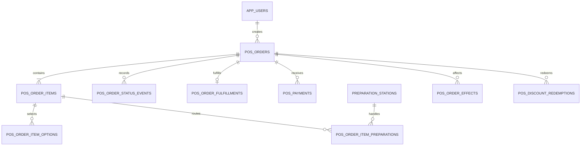

# POS V3 — مدل داده سفارش و ERD نسخه تجاری

- تاریخ: 2026-11-19
- وضعیت: طراحی منطقی برای بازبینی؛ هنوز schema اجرایی نیست.
- مرجع چرخه عملیاتی: `ORDER_LIFECYCLE_STOREFRONT_V3.md`
- مرجع مالی: `PAYMENT_LEDGER_V3.md`
- هدف نصب: دیتابیس تازه MySQL/InnoDB؛ بدون انتقال داده V2.

## 1. یافته از schema فعلی

بازبینی `php-backend/schema.sql` نشان می‌دهد:
- `pos_orders` اکنون یک وضعیت عملیاتی محدود، `payment_method` و payloadهای JSON برای items/totals دارد.
- کانال سفارش، نوع دریافت، وضعیت مستقل پرداخت/تحویل و تاریخچه وضعیت مستقل مدل نشده‌اند.
- ردیف‌های سفارش و گزینه‌های انتخابی به‌صورت رابطه‌ای و snapshot مستقل قابل query نیستند.
- `pos_order_effects` برای اثرهای برگشت‌پذیر موجودی/مشتری وجود دارد و باید به سفارش پایدار متصل بماند.
- `pos_records` مخزن عمومی JSON برای چند resource است؛ برای اسناد حیاتی سفارش/پرداخت/موجودی نباید منبع حقیقت اصلی باقی بماند.
- `pos_terminal_payments` تراکنش کارتخوان را ثبت می‌کند، اما جای دفتر عمومی پرداخت را نمی‌گیرد.

این یافته‌ها صرفاً مبنای طراحی‌اند؛ هیچ جدول فعلی در این مرحله حذف یا تغییر داده نشده است.

## 2. اصول مدل داده

1. یک سفارش با چند ردیف مستقل؛ هر ردیف snapshot نام، شناسه محصول، قیمت و گزینه‌ها را حفظ می‌کند.
2. کانال سفارش، نوع دریافت، وضعیت عملیاتی، آماده‌سازی، تحویل و پرداخت مستقل‌اند.
3. مبلغ‌ها با عدد صحیح در کوچک‌ترین واحد تجاری مصوب (در محصول فعلی تومان) ذخیره می‌شوند؛ واحد در کل سیستم ثابت و صریح است.
4. سفارش ثبت‌شده، ردیف‌ها، قیمت‌ها و رویدادهای گذشته با ویرایش کاتالوگ تغییر نمی‌کنند.
5. تغییر وضعیت فقط از transition معتبر عبور می‌کند و event append-only می‌سازد.
6. idempotency برای سفارش عمومی و داخلی الزامی است.
7. هم‌زمانی موجودی و رزرو باید در transaction و با قفل/کنترل نسخه انجام شود.
8. داده عمومی مشتری از طریق token hash غیرقابل حدس قابل دسترسی باشد؛ شناسه ترتیبی سفارش به‌تنهایی مجوز دسترسی نیست.
9. داده‌های عملیاتی سفارش رابطه‌ای باشند؛ JSON فقط برای snapshot/metadata محدود و نسخه‌بندی‌شده به کار رود.
10. این مدل در نسخه اول تک‌شعبه‌ای قابل اجراست؛ شناسه کسب‌وکار/شعبه در صورت نیاز آینده به شکل کنترل‌شده افزوده می‌شود، بدون ورود UI چندشعبه‌ای به نسخه اول.

## 3. ERD مفهومی

## 4. جداول سفارش

### 4.1 `pos_orders` — سربرگ سفارش

فیلدهای پیشنهادی:
- `id` BIGINT UNSIGNED PK.
- `order_number` BIGINT UNSIGNED؛ شماره نمایشی یکتا و قابل تنظیم از شمارنده.
- `source_channel` ENUM: `pos_counter, staff_phone, staff_manual, table_service, takeaway, storefront, external_integration`.
- `order_type` ENUM: `dine_in, takeaway, delivery`.
- `status` ENUM: `draft, placed, confirmed, preparing, ready, completed, cancelled`.
- `fulfillment_status` ENUM: `not_applicable, awaiting_pickup, assigned, out_for_delivery, delivered, delivery_failed`.
- `payment_status` ENUM: `unpaid, partially_paid, paid, partially_refunded, refunded, reconciliation_required`; خلاصه‌ای که از دفتر پرداخت محاسبه و در transaction به‌روز می‌شود، نه منبع حقیقت مستقل.
- `customer_id` nullable و `customer_name_snapshot`, `customer_phone_snapshot`.
- `created_by` nullable فقط برای سفارش عمومی storefront؛ `created_by_channel`/actor مشخص می‌کند مشتری یا کارمند سفارش را ثبت کرده است.
- `idempotency_key` و `request_hash` با unique constraint مناسب.
- `subtotal_amount`, `discount_amount`, `tax_amount`, `delivery_fee_amount`, `total_amount` با BIGINT UNSIGNED و واحد پول ثابت.
- `currency` CHAR(3) با مقدار مصوب `IRT`.
- `customer_note` و `internal_note` جدا؛ یادداشت داخلی هرگز به storefront یا آشپزخانه‌ای که مجوز ندارد نشت نکند.
- `placed_at`, `completed_at`, `cancelled_at`, `created_at`, `updated_at`.
- Index روی `(status, created_at)`, `(source_channel, created_at)`, `(payment_status, created_at)`, `(customer_id, created_at)`.
- شماره سفارش و کلید idempotency با unique index محافظت شوند.

قید مهم: سفارش `storefront` می‌تواند actor کارمند نداشته باشد؛ مسیرهای داخلی باید همچنان actor احراز هویت‌شده و مجاز داشته باشند.

### 4.2 `pos_order_items` — ردیف‌های سفارش

- `id` BIGINT UNSIGNED PK و `order_id` FK.
- `product_id` شناسه مرجع محصول nullable برای محصولی که بعداً حذف/غیرفعال می‌شود.
- `sku_snapshot` اختیاری، `name_snapshot`, `description_snapshot`.
- `quantity` DECIMAL(14,3) و `unit_label_snapshot`.
- `unit_price_amount`, `discount_amount`, `tax_amount`, `line_total_amount` عدد صحیح.
- `recipe_snapshot_version`/metadata محدود در صورت اتصال رسپی.
- `line_note`, `sort_order`, timestamps.
- FK به سفارش با ON DELETE RESTRICT؛ اسناد سفارش حذف فیزیکی نشوند.

### 4.3 `pos_order_item_options` — افزودنی و انتخاب محصول

- `id`, `order_item_id` FK.
- `option_group_id` nullable؛ `option_id` nullable.
- `group_name_snapshot`, `option_name_snapshot`.
- `quantity` DECIMAL(14,3), `unit_price_delta_amount`, `total_delta_amount`.
- `is_required_snapshot`, `sort_order`.
- انتخاب‌های آزاد/متنی فقط با validation و محدودیت طول ذخیره شوند.
- Snapshot باید برای چاپ و بازبینی سفارش کافی باشد، حتی اگر گزینه از کاتالوگ حذف شود.

## 5. رویدادها و آماده‌سازی

### 5.1 `pos_order_status_events`
Append-only:
- `id`, `order_id`, `from_status`, `to_status`, `reason_code`, `reason_text`.
- `actor_user_id` nullable برای رویداد مشتری/سیستم؛ `actor_type` و `source_channel`.
- `idempotency_key` nullable/unique در دامنه مناسب.
- `metadata` JSON پالایش‌شده و نسخه‌بندی‌شده.
- `created_at`; index بر order/time.
- API نباید update/delete عمومی برای event فراهم کند.

### 5.2 `preparation_stations`
- شناسه، نام، نوع (kitchen/bar/packing/other)، فعال‌بودن، ترتیب و تنظیمات چاپ.
- برای نسخه اول یک کسب‌وکار می‌تواند یک یا چند ایستگاه تعریف کند.

### 5.3 `pos_order_item_preparations`
- `id`, `order_item_id`, `station_id`.
- `status`: `queued, preparing, ready, cancelled`.
- `quantity`, زمان شروع/پایان، عامل شروع/تکمیل و timestamps.
- یک ردیف سفارش می‌تواند چند task داشته باشد؛ کل سفارش زمانی ready می‌شود که همه taskهای لازم آماده باشند و قواعد تحویل/پرداخت اجازه دهد.

## 6. دریافت و ارسال

### 6.1 `pos_order_fulfillments`
یک رکورد fulfillment برای هر سفارش نسخه اول:
- `order_id` unique FK.
- `method`: `dine_in, pickup, delivery`.
- `status`: وضعیت‌های تحویل تعریف‌شده در چرخه سفارش.
- `table_label_snapshot` یا `table_id` در صورت میز.
- `recipient_name`, `recipient_phone`, `address_snapshot` فقط برای delivery.
- `delivery_fee_amount`, `scheduled_for`, `estimated_ready_at`.
- `courier_user_id` nullable؛ بدون فرض اپ پیک مستقل.
- timestamps و علت شکست/لغو.
- دسترسی به نشانی فقط برای نقش‌های لازم؛ آشپزخانه این داده را دریافت نمی‌کند.

### 6.2 کنترل اطلاعات عمومی سفارش
- برای پیگیری storefront، `public_tracking_token_hash` یا token جداگانه در جدول access نگهداری شود؛ token خام فقط یک‌بار به مشتری داده شود.
- endpoint عمومی باید اطلاعات حداقلی و rate-limited برگرداند.
- اطلاعات تماس/نشانی و یادداشت داخلی از پاسخ عمومی حذف شوند.

## 7. ارتباط با دفتر پرداخت

- `pos_payments.order_id` به `pos_orders.id` متصل است.
- هر سفارش می‌تواند صفر تا چند payment داشته باشد.
- روش پرداخت از source_channel مستقل است.
- callback درگاه فقط پس از تأیید server-to-server یک payment موفق ایجاد/تکمیل می‌کند.
- خلاصه `payment_status` باید از payment/refund ledger بازسازی‌پذیر باشد.
- لغو سفارش و refund عملیات جدا هستند.

## 8. رابطه با موجودی و رسپی

- کسر/رزرو مواد از یک مسیر مرکزی انجام شود تا POS و storefront دو بار موجودی را تغییر ندهند.
- `pos_order_effects` فقط اثرهای دقیق و برگشت‌پذیر سفارش را نگه می‌دارد؛ ledger عمومی موجودی در طراحی انبار جداگانه منبع حقیقت گردش موجودی خواهد بود.
- در سفارش دارای رسپی، snapshot نسخه رسپی هنگام ثبت سفارش حفظ شود.
- لغو/مرجوعی، اثر موجودی را طبق سیاست مصوب و با event/ledger معکوس کند؛ حذف اثر قبلی مجاز نیست.

## 9. تصمیم‌های باز پیش از DDL

مواردی که باید پیش از نوشتن schema نهایی با سورس و قواعد محصول تطبیق داده شوند:
1. آیا `status` و `fulfillment_status` enum بمانند یا جدول transition قابل تنظیم لازم است؟
2. مدل میز/سالن در نسخه اول: جدول رابطه‌ای کامل یا شناسه/نام snapshot برای شروع؟
3. آیا سفارش storefront پیش از پرداخت در `draft/pending_payment` ذخیره می‌شود یا payment intent در جدول جدا؟
4. قاعده پذیرش سفارش قبل از پرداخت و پرداخت در محل.
5. مدل حذف/غیرفعال‌سازی محصول و FK تاریخی.
6. رفتار سفارش چندایستگاهی در لغو جزئی اقلام.
7. سیاست رزرو موجودی و ظرفیت آماده‌سازی هنگام پرداخت ناموفق/timeout.
8. سازگاری MySQL نسخه هدف با CHECK/JSON/index و collation؛ قیدهای حیاتی نباید فقط به CHECK وابسته باشند.

## 10. دروازه پذیرش پیش از پیاده‌سازی

- ERD با دفتر پرداخت و دفتر موجودی تعارض نداشته باشد.
- تمام روابط FK، unique، index و on-delete policy مشخص باشند.
- نصب schema تازه و اجرای دوباره migrationها امن باشد.
- سفارش عمومی بدون کاربر داخلی امن باشد؛ سفارش داخلی بدون actor مجاز رد شود.
- snapshot قیمت و گزینه‌ها در تغییر بعدی کاتالوگ ثابت بماند.
- retry و race condition موجب سفارش یا رزرو تکراری نشود.
- queryهای صف صندوق، آشپزخانه، storefront و گزارش با index قابل قبول باشند.
- backup/restore تمام جداول سفارش، رویدادها، fulfillment و payment را حفظ کند.

## 11. محدودیت

این ERD طراحی منطقی است، نه DDL تأییدشده. پیش از تغییر `schema.sql` باید تمام مصرف‌کننده‌های فعلی API/UI، نصب‌کننده، backup/restore و تست‌ها بررسی شوند. چون داده‌های V2 قرار نیست منتقل شوند، مدل نهایی می‌تواند تمیز و رابطه‌ای باشد؛ اما پس از انتشار تجاری، تغییرات باید migration نسخه‌بندی‌شده و backward-safe داشته باشند.
